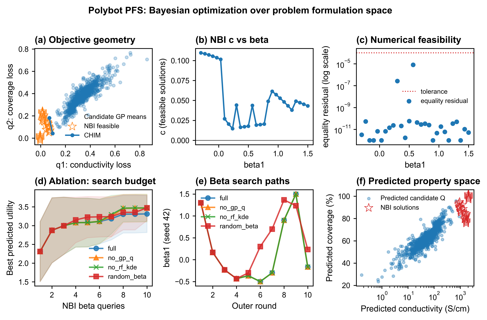
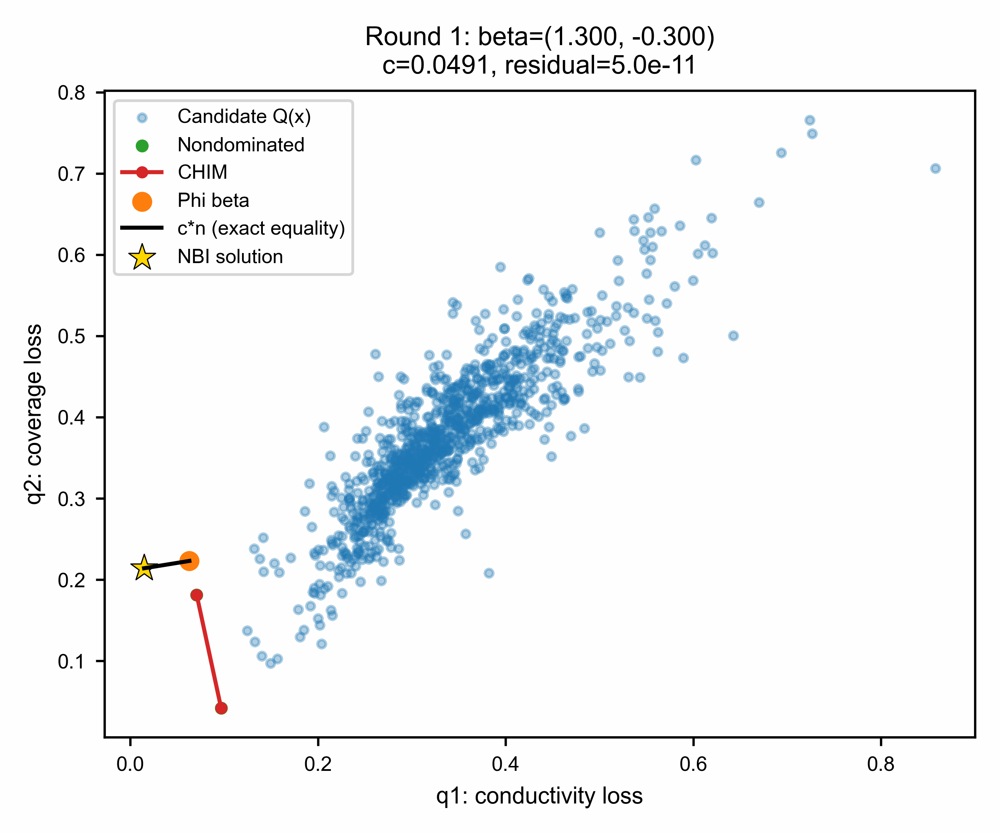

## 1 Materials selection
**monomer** = EDOT

**polyanion** = styrene sulfonic acid (SSA, `default`), 

dextran sulfate sodium (DS), 

> Acta Biomaterialia 14 (**2015**) 33-42, [10.1016/j.actbio.2014.11.049](https://www.sciencedirect.com/science/article/pii/S1742706114005522?via%3Dihub)

chondroitin sulfate (CS), hyaluronic acid (HA), heparin (HEP), 
> Macromolecular Bioscience. 16 (**2016**), 1227-1238,  [10.1002/mabi.201600059](https://onlinelibrary.wiley.com/doi/10.1002/mabi.201600059)

**conditions** =

$m_{EDOT}:m_{PA}$= 1:2, 1:1, 2:1

$time$ = 1, 2, 6, 12, 24 h

$temperature$ = 20, 30, 40, 50 °C

**oxidant** =
$Na_2S_2O_8 / EDOT$ mol% 1.2–2.0 eq

**catalyst** = 
$Fe_2(SO_4)_3 / EDOT$ mol% 0.1–1 mol%

## 2 Model design

Inspired by the work **Problem Formulation Space (PFS)**, from J. Wagner *et al*. 

>Materials & Design 269 (**2026**) 116585, [10.1016/j.matdes.2026.116585](https://www.sciencedirect.com/science/article/pii/S0264127526011603?via%3Dihub)

### 2.1 Define target properties

**Electrical conductivity $\sigma$ (S/cm)**

**Transparency $AVT$ (%)**

> $$AVT=\frac{\int_{400}^{700}T(\lambda)d\lambda}{700-400}$$ 
> $$T(\lambda)=10^{-A(\lambda)}$$
> 
**Target is to maximize both $AVT$ and $\sigma$.**

> *Note:* check correlation between $AVT$ and $\sigma$

### 2.2 Define design variables

```
experimental variables = {
    polyanion, # category 
    EDOT:PA ratio, # continuous
    time, # continuous
    temperature, # continuous
    Na2S2O8/EDOT ratio, # continuous
    Fe2(SO4)3/EDOT ratio, # continuous
    }
```

### 2.3 Explanation of PFS

**step 1 experimental table**
> target properties: Q1 & Q2, and minimize them
> 
---

**step 2 loss normalization**
| experiment no. | Q1 | Q2 |
| --- | --- | --- |
| A | 2.0 | 0.8 |
| B | 0.5 | 0.5 |
| C | 0.9 | 2.0 |

so two extreme points are 

> E1 (2.0,0.8) for Q1 max
> 
> E2 (0.9, 2.0) for Q2 max

for Q1 best value:

$$Q_{1}^{best}=2.0$$

for Q1 worst value:

$$Q_{1}^{worst}=0.5$$

so the normalized Q1:

$$Q_{1}^{norm}=\frac{Q_1-0.5}{2-0.5}$$

the same process for Q2

Then, the normalized Q1 and Q2:

| experiment no. | Q1 | Q2 |
| --- | --- | --- |
| A | 1.0 | 0.267 |
| B | 0 | 0 |
| C | 0.267 | 1.0 |

---

**step 3 construct CHIM**
CHIM is the line connecting extreme points:

$$CHIM=E_1+\lambda(E_2-E_1)$$

Now we define $\beta$ means how important the Q1 and Q2 are, for example: $\beta=(0.8,0.2)$ means the Q1 is 4 times more important than Q2.

For a given preference vector $\beta$, we define a **$\Phi_\beta$** as:

$$\Phi_\beta=0.8E_1+0.2E_2$$

integrate the values, then we can get:

$$\Phi_\beta=(1.78,1.04)$$

Next, we define a normal vector **$n$** satisfing:

$$n\cdot(E_2-E_1)=0$$

Lastly, we can define a **$c$** representing the distance how long we exploring, and the target is to find:

> ${max}_{x,c}\ c$ to satisfy $Q(x_i)=\Phi_\beta+c n$

---

**step 4 find different $x_i$ (composition)**

for each $x_i$, we can calculate the corresponding $Q(x_i)$ (the properties).

Then we can define an **$\epsilon$** as a threshold:

$$||Q(x_i)-(\Phi \beta +cn)||<\epsilon$$

where the $Q(x_i)$ is from composition $x_i$, and the $(\Phi \beta +cn)$ is from the PFS.

So there's a loop as follows:

```
x_i-->Q(x_i)-->PFS calculation-->find c-->satisfy threshold epsilon
```

finally, we will care about the $c_{max}$

---

**step 5 utility funciton**
we define a utility function to evaluate the performance of each $x_i$:

$$U(x_i)=\sum_{i} \alpha_i u(Q(x_i))_i$$

$$u_i = sigmoid/ReLU/tanh/...$$

where $\alpha_i$ is the weight for each property, and $u_i$ is the normalized utility function for each property.

---

**step 6 exploration of $\beta$**
So far, the $\beta$ was defined by human, but what about exploration of $\beta$? That's the core of PFS.

We use kernel density estimation (KDE) to estimate the distribution of $\beta$ based on the previous experiments, and then we can sample new $\beta$ from the estimated distribution.

---

**step 7 feasibility control**

for each $x_i$ and $\beta$, we can define a feasibility function to evaluate whether the experiment is successful or not:

$$
y(x_i,\beta)=
\begin{cases}
1,& experiment\ successful\\
0,& experiment\ failed
\end{cases}
$$

### 2.4 Model construction

| Space | Model | Input | Output | Role |
|-|-|-|-|-|
| Material space $x$ | GP-Q | $x$ | $\hat Q(x)$ | predict conductivity and AVT |
| Problem space $\beta$ | KDE | historical $\beta$ | $p(\beta)$ | explore preference space |
| NBI utility | ML-NBI | $\hat Q(x),\beta$ | $U(x,\beta)$ | calculate formulation utility |
| Joint space $(x,\beta)$ | GP-U | $(x,\beta)$ | $\hat U(x,\beta)$ | predict utility |
| Feasibility | RF | $x$ | $P_f(x)$ | synthesis feasibility |
| Acquisition | logEI | $\hat U,P_f$ | next $x,\beta$ | select experiment |

## 3 Toy experiment

### 3.1 Model settings
dataset = `PEDOT_PSS_supporting_data/PEDOT_experiment.csv`, from the work of Chengshi Wang *et al*., named [Polybot](https://github.com/polybot-nexus/PEDOT_PSS_supporting_data/blob/main/PEDOT_experiment.csv)

> Nature Communications 16 (**2025**), 1498, [10.1038/s41467-024-55655-3](https://doi.org/10.1038/s41467-024-55655-3)

target = `Average conductivity (S/cm)` and `Average coverage (%)`
> the target is to maximize both $\sigma$ and $coverage$

utility function is $U(x)=1.5\,ReLU(\sigma)+1.0\,ReLU(coverage)$
> just for a try

### 3.2 Results



**Figure 1 | Demonstration of Bayesian optimization over problem formulation space for multi-objective PEDOT:PSS optimization. The PFS framework jointly explores experimental design space $x$ and problem formulation space $\beta$.** a, Objective-space representation of candidate solutions, CHIM, and NBI-derived optimal conditions. b, Optimized NBI displacement $c$ as a function of formulation vector $\beta$, showing formulation-dependent optimization landscapes. c, Equality residual analysis validating the numerical satisfaction of the NBI constraint $Q(x)=\Phi\beta+cn$. d,e, Ablation studies and formulation trajectories comparing the complete PFS framework with reduced models. f, Predicted conductivity–coverage landscape highlighting the high-performance regions identified by PFS.



**Figure 2 | The animation of NBI process, which is the core process of PFS**

The suggested optimal conditions (`results_v9/next_experiment.json`):

```
{
  "status": "predicted_not_experimentally_validated",
  "recommendation_basis": "best NBI solution actually queried by full PFS, first seed",
  "selected_beta": [
    -0.16666667,
    1.16666667
  ],
  "selected_round": 10,
  "experimental_conditions": {
    "DMSO concentration (Vol%)": 0.0,
    "EG concentration (Vol%)": 4.8897795135621855,
    "Coating speed (mm/sec)": 1.1356300571871132,
    "Coating temperature (Celsius)": 93.69397960169118,
    "Post-processing solvent No.": 5,
    "Post-processing solvent MeOH (vol%)": 60.0,
    "Post-processing solvent EtOH (vol%)": 40.0,
    "Post-processing solvent H2O (vol%)": 0.0,
    "Post coating speed (mm/sec)": 1.1702676772033507,
    "Post coating temperature (Celsius)": 68.77378613034858
  },
  "predictions": {
    "conductivity_S_per_cm": 2083.8585183123523,
    "coverage_percent": 100.0666961200221,
    "utility": 3.590247971962171,
    "nbi_c": 0.10714857133226062,
    "nbi_equality_residual": 5.549489744174483e-13,
    "q1_conductivity_loss": -0.004277170997508548,
    "q2_coverage_loss": -0.0006669612002210279
  },
  "minimum_thresholds": {
    "conductivity_S_per_cm": 665.0,
    "coverage_percent": 72.0
  },
  "limitations": [
    "Fixed property GP predictions, not lab measurements",
    "SLSQP local optimum only",
    "Check chemical feasibility and experimental uncertainty before execution"
  ]
}
```